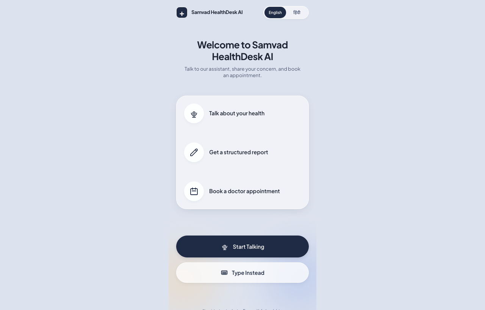
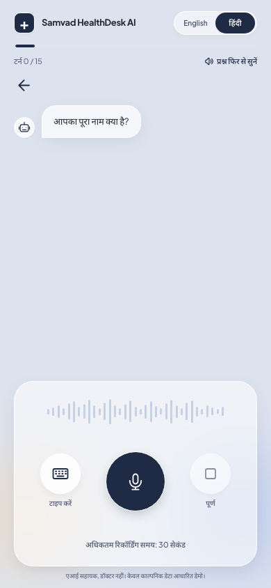
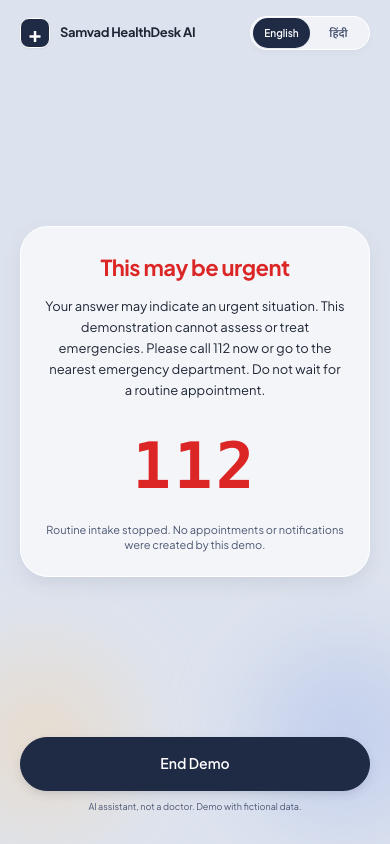
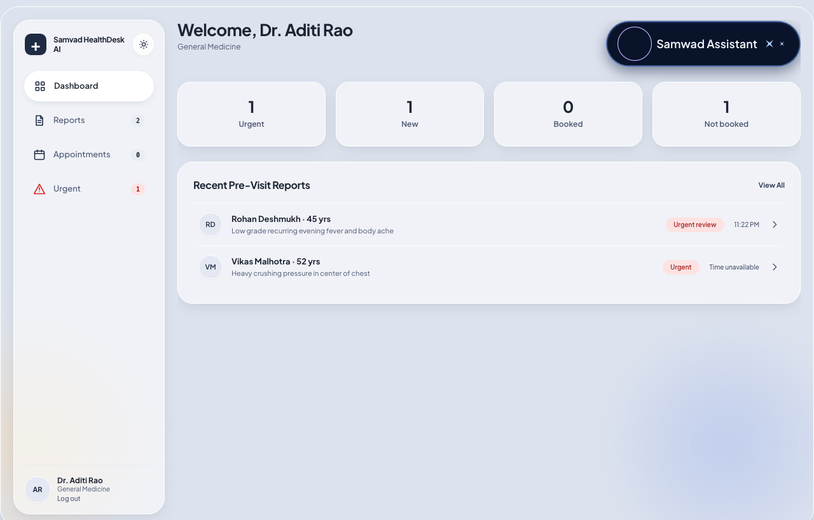
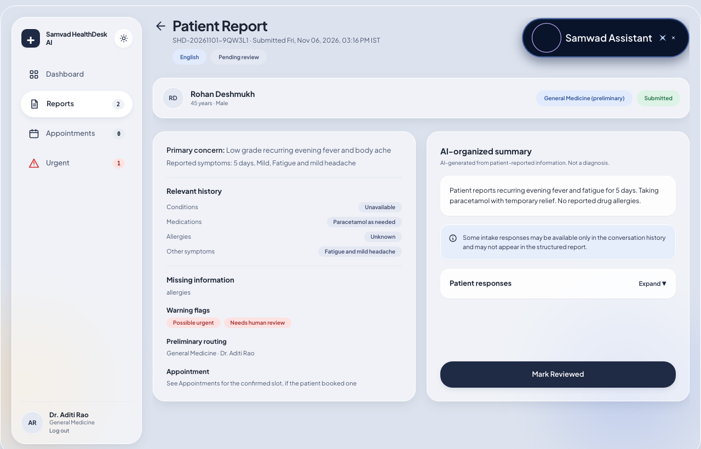
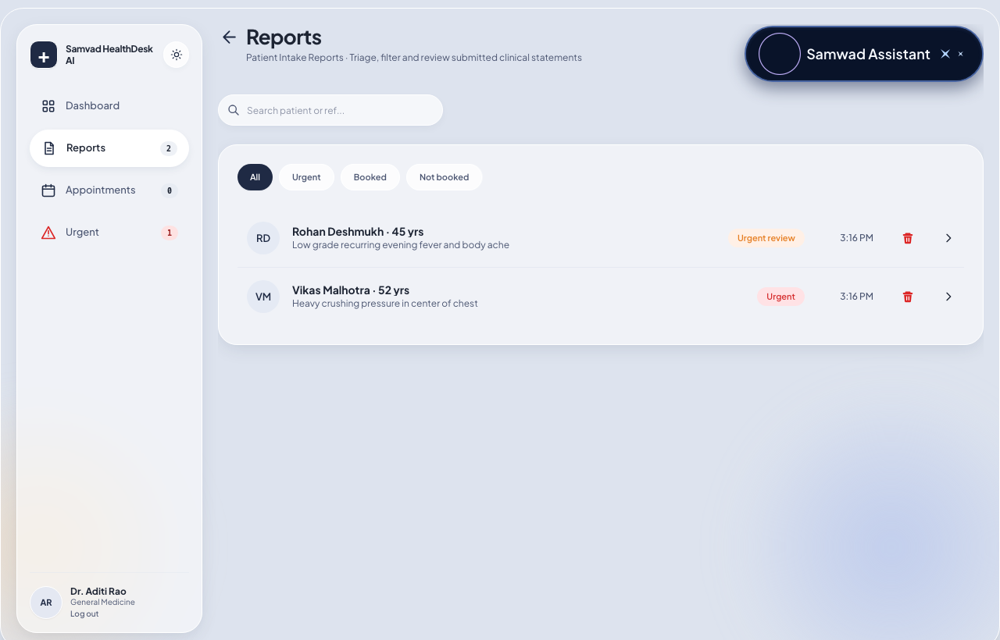
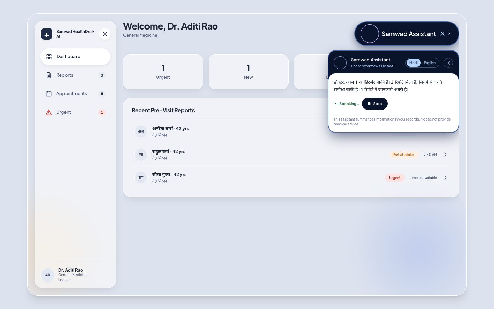

# Samvad HealthDesk AI

**AI-assisted bilingual pre-visit patient intake, smart department referral, and voice-enabled doctor desk.**

[](https://www.typescriptlang.org/)
[](https://react.dev/)
[](https://vitejs.dev/)
[](https://tailwindcss.com/)
[](https://supabase.com/)

> [!IMPORTANT]
> **Educational demonstration only — synthetic data only.** Samvad HealthDesk AI is a non-clinical educational prototype using synthetic patient scenarios, fictional doctors, and fictional outpatient schedules. It **never diagnoses, estimates disease probability, prescribes, recommends treatment, or dispatches emergency services**. Do not enter real patient information (PHI) or use it for medical decisions.

---

## Overview & Problem Solved

In busy outpatient clinics and multilingual care settings, pre-visit history collection is slow and fragmented: patients often speak in regional languages such as Hindi, while clinical documentation and intake queues are in English.

**Samvad HealthDesk AI** demonstrates an auditable, guardrail-driven pre-visit intake workflow connecting two focused interfaces in one responsive Single Page Application:

```text
Welcome (Hindi / English) → Explicit Consent → Voice / Text Intake → Draft Report & Corrections
   → Patient Submit → Preliminary Department & Doctor Mapping → Doctor Portal (/doctor) → Optional Appointment Booking
```

---

## Screenshots

### Patient Experience (Bilingual Voice-First Intake & 112 Safety Gate)

| Bilingual Welcome (`1280×820`) | Hindi Voice Conversation (`390×844`) | Deterministic 112 Safety Path (`390×844`) |
|---|---|---|
|  |  |  |

### Doctor Portal & Samwad Assistant (`/doctor`)

| Doctor Dashboard (`1280×820`) | Structured Report Detail (`1280×820`) |
|---|---|
|  |  |

| Filterable Reports Queue (`1280×820`) | Samwad Assistant Active Hindi Briefing (`1440×900`) |
|---|---|
|  |  |

---

## Key Features

### Patient Portal (`/`)
- **Bilingual interface:** Full English (`en`) and Hindi (`hi`, Devanagari script with `Noto Sans Devanagari`) switchable from the welcome screen.
- **Voice-first intake with text fallback:** Patients choose **Start Talking** or **Type Instead**, backed by browser microphone recording (`30 s` cap), **Web Audio Voice Activity Detection (VAD)** automatic stop after `2.0 s` sustained silence, and client-side re-encoding to `16 kHz` mono 16-bit PCM WAV.
- **Cached opening audio:** Pre-generated Gnani Timbre MP3 files under [`public/audio/`](public/audio/README.md) speak the greeting and initial scripted prompts without runtime TTS calls.
- **Explicit on-screen consent:** Versioned consent (`2026-11-01.v1`) recorded via Yes/No controls only; declining ends immediately without storing health data.
- **Scripted opening + adaptive v2 question bank:** Sequential opening fields (`name`, `age`, `gender`, `primary_concern`) followed by adaptive selection from a **150-question bilingual bank** (`30` questions across 5 routine departments) with quick-reply chips, editable **"What we heard"** voice transcripts, and replay controls.
- **Session & partial-report guardrails:** Strict server-side cap of **15 accepted answer turns** (`incomplete_cap` ends privately), plus an option to finish early and send a **`partial`** report (v1.3) after at least 3 accepted answers.
- **Patient-controlled review & booking:** Patients can correct allowlisted fields, choose **Submit to hospital** or **Don't submit**, and book an `Asia/Kolkata` slot for their mapped doctor or choose **Not now** (leaving the report visible without an appointment).
- **Deterministic emergency gate:** Bilingual rule matching with negation checks and explicit clarification prompts halts routine intake, displays plain-text `112` guidance, creates an `urgent_partial` report for Emergency triage, and permanently suppresses routine slots.

### Doctor Portal (`/doctor`)
- **Authenticated, RLS-scoped access:** Restricted to mapped `doctor_profiles` via Supabase Auth (English-only portal; credentials shared only through private evaluator channels).
- **Dashboard & queues:** KPI summary cards (`Reports Today`, `Pending Review`, `Urgent Alerts`, `Appointments`), `All` / `Urgent` / `Booked` / `Not booked` filter tabs, search by name/concern/reference, missing-information & `PARTIAL INTAKE` indicators, and permanent report deletion (`delete_doctor_report` RPC with confirmation modal).
- **Report Detail & `Mark Reviewed`:** Structured English summary, warning flags, missing-value states (`not_provided`, `unknown`, `declined`, `unclear`, `not_asked`), and conversation transcript. Enforces owner decision **D-30**: only the mapped Emergency doctor can mark an emergency report reviewed (with read-only visibility for the General Medicine demo doctor).
- **Appointments view:** `Today` / `Upcoming` / `Past` tabs derived directly from `Asia/Kolkata` slot timestamps, plus light/dark theme toggle.

### Samwad Assistant (`/doctor` Header Pill)
- **Contextual page summaries:** Available in the upper-right header of all six doctor views (`Dashboard`, `Reports`, `Report Detail`, `Urgent Queue`, `Urgent Detail`, `Appointments`).
- **Once-per-login dashboard briefing:** Automatically briefs the doctor once per login session (guarded synchronously via a `sessionStorage` login nonce so tab navigation and token refreshes never replay it).
- **Grounded two-stage generation:** Stage A computes deterministic counts and statuses directly from RLS-scoped records; Stage B optionally asks **Groq (`qwen/qwen3.8-27b`)** to phrase the concise briefing while `validateModelSummary` rejects unsupported numbers, patient identifiers, diagnoses, or contact claims and falls back cleanly.
- **Selectable Hindi & English speech:** Doctors can toggle the summary between Hindi (`hi`, default) and English (`en`) and hear the summary read aloud via **Gnani Timbre (`timbre-v2.5`)** through a single global audio channel (`Stop` / `Replay` controls).

---

## Technology Stack & Architecture

```text
Browser SPA (React 18 + Vite 6 + TypeScript + Tailwind CSS 3, deployed as static site via vercel.json)
   │  Single frontend gateway: src/lib/api.ts
   ├──► Supabase PostgreSQL + Auth + RLS (15 migrations)
   │       • Caller-scoped doctor reads + allowlisted SECURITY DEFINER RPCs
   │         (get_available_slots, book_appointment, mark_report_reviewed,
   │          get_doctor_appointments, delete_doctor_report)
   │       • Atomic IST daily usage caps (reserve_daily_usage, service_role only)
   └──► Supabase Edge Functions (Deno, verified JWT required)
           ├── chat-turn ──► Groq (qwen/qwen3.8-27b, strict JSON Schema)
           │             └──► Gnani Prisma v2.5 (POST /stt/v3, audio/wav|mp3|ogg|flac|aac|m4a)
           └── speak     ──► Groq (validated assistant summary phrasing)
                         └──► Gnani Timbre (timbre-v2.5, voices Kaveri & Nalini, 24 kHz MP3)
```

| Layer | Technology / Specification |
|---|---|
| **Frontend** | React 18, Vite 6, TypeScript 5 (strict), Tailwind CSS 3, React Router 6 (lazy-loaded `/doctor` shell), Web Audio API VAD & WAV encoder |
| **UI Design & Hosting** | Responsive layout implemented from Figma design specs & tokens; static SPA rewrite configured in [`vercel.json`](vercel.json) |
| **Backend & Database** | Supabase PostgreSQL (RLS on all public tables, 15 SQL migrations), Supabase Auth (anonymous patients + doctor email/password), two Deno Edge Functions (`chat-turn`, `speak`) |
| **LLM Reasoning** | Groq API (`https://api.groq.com/openai/v1/chat/completions`), model `qwen/qwen3.8-27b` with `response_format.json_schema` (`strict: true`) & deterministic scripted fallbacks |
| **Speech-to-Text** | Gnani Prisma v2.5 (`POST https://api.vachana.ai/stt/v3`, max 30 s audio upload) |
| **Text-to-Speech** | Gnani Timbre (`timbre-v2.5` via `POST https://api.vachana.ai/api/v1/tts/inference`, `Kaveri` for `en-IN`, `Nalini` for `hi-IN`) |

### Deployment & Live Demo Status
- **Live Demo (Vercel Production SPA):** <https://samvad-healthdesk-ai.vercel.app>
- This repository contains a complete Vercel SPA configuration ([`vercel.json`](vercel.json)) and Supabase backend setup (15 SQL migrations, seeds, and Edge Functions).
- Out of the box locally without environment variables, the frontend starts in a complete **built-in offline mock mode** so visitors can explore both patient and doctor journeys on `http://localhost:5173`, or deploy to their own Vercel + Supabase instances using the runbooks under [`docs/`](docs/environment-variables.md).

---

## Departments & Synthetic Seed Data

| Department | Fictional Clinician | Routine Booking |
|---|---|---|
| General Medicine (`general_medicine`) | Dr. Aditi Rao | Enabled (weekdays `09:00–17:00` IST, `13:00–14:00` lunch excluded) |
| Orthopedics (`orthopedics`) | Dr. Kabir Mehta | Enabled |
| General Surgery (`general_surgery`) | Dr. Ishaan Patel | Enabled |
| Dermatology (`dermatology`) | Dr. Sara Khan | Enabled |
| Cardiology (`cardiology`) | Dr. Arjun Nair | Enabled |
| Emergency (`emergency`) | Dr. Neha Verma | **No routine slots** (emergency triage only) |

---

## Getting Started

### Prerequisites
- **Node.js** `18+` and **npm** (verified with Node `v26.12.0`)
- Optional: **Deno** (`v2.x`), **Google Chrome** (for headless browser QA), **Docker + Supabase CLI** (for local full-stack database & Edge Function integration tests)

### 1. Run Locally (Instant Offline Mock Mode)

With no environment variables configured, `src/lib/api.ts` runs locally in built-in mock mode with synthetic records and zero network/provider calls:

```bash
git clone https://github.com/Shyamparmarsp/samvad-healthdesk-ai.git
cd samvad-healthdesk-ai
npm ci
npm run dev
```

- Patient Intake: `http://localhost:5173/`
- Doctor Portal: `http://localhost:5173/doctor` (mock mode uses fictional `.hospital.demo` accounts)

### 2. Optional Full Supabase + Provider Mode

```bash
cp .env.example .env.local
# Populate VITE_SUPABASE_URL and VITE_SUPABASE_KEY (publishable/anon key only)
npm run build
npm run preview
```

For hosted database migrations, Edge Functions (`chat-turn`, `speak`), secrets configuration, and doctor profile mapping (`scripts/map-doctor-profiles.ts`), see:
- [`docs/backend-deployment-runbook.md`](docs/backend-deployment-runbook.md)
- [`docs/frontend-deployment-runbook.md`](docs/frontend-deployment-runbook.md)
- [`docs/doctor-onboarding.md`](docs/doctor-onboarding.md)

---

## Environment Variables (Names Only — Never Commit Secrets)

| Scope | Variable Name | Purpose |
|---|---|---|
| **Browser (Vercel / `.env.local`)** | `VITE_SUPABASE_URL` | Public Supabase project URL (or `http://127.0.0.1:54321` locally) |
| **Browser (Vercel / `.env.local`)** | `VITE_SUPABASE_KEY` | Public Supabase publishable or anon key (**never** a secret/service-role key) |
| **Supabase Edge Function Secrets** | `GROQ_API_KEY` | Server-side Groq (`qwen/qwen3.8-27b`) key |
| **Supabase Edge Function Secrets** | `GNANI_API_KEY` | Server-side Gnani Prisma STT & Timbre TTS key |
| **Supabase Edge Function Secrets** | `ALLOWED_ORIGINS` | Comma-separated exact allowed frontend origins for CORS |

See [`docs/environment-variables.md`](docs/environment-variables.md) and [`.env.example`](.env.example) for optional local stub overrides and local testing variables.

---

## Verification & Testing

```bash
# Typecheck & production bundle
npx tsc --noEmit && npm run build

# Offline frontend unit, contract, VAD, assistant, and report-delete suites
npm run test:mock
npm run test:supabase
npm run test:assistant
npm run test:delete

# Backend Edge Function checks, Deno tests & question-bank integrity
deno check --config supabase/functions/deno.json supabase/functions/chat-turn/index.ts supabase/functions/speak/index.ts
(cd supabase/functions/_shared && deno test --allow-read --allow-env)
deno run --allow-read --allow-env=BANK_REVIEW_CSV scripts/verify-question-bank-integrity.ts
deno run --allow-read scripts/export-contract-fixtures.ts --check
deno test --allow-read --allow-env supabase/tests/prompt-audio-manifest.test.ts supabase/tests/provider-roundtrip.test.ts supabase/tests/provider-smoke.test.ts supabase/tests/demo-lifecycle.test.ts

# Headless Chrome visual & E2E suites (use SCREENSHOT_OUT_DIR to avoid dirtying docs/screenshots/)
SCREENSHOT_OUT_DIR=/tmp/samvad-qa npm run build:mock
```

Full-stack PostgreSQL RLS & Edge Function integration suites (`npm run test:api`, `supabase/tests/*.sql`) require Docker + `npx supabase start`. See [`supabase/tests/README.md`](supabase/tests/README.md) and [`tests/api/README.md`](tests/api/README.md).

---

## Security & Licensing

- **Security reporting:** See [`SECURITY.md`](SECURITY.md) for responsible disclosure instructions and an overview of RLS / Edge Function isolation boundaries. Never commit working passwords, API keys, or real patient data.
- **License:** Source code is publicly viewable. No licence is currently granted for copying, modifying or redistributing this project.
