# Visual Parity Report

**Method.** Each of the 22 Figma frames was rendered from the original file at native size and placed side by side with a screenshot of the running build captured at the same viewport (390×844 for patient, 1280×820 for doctor). No image was resized, cropped or distorted for presentation; the sheets pad to equal height and keep both images at 1:1. Sheets: `evidence/comparison/<node>-comparison.png`. Contact sheets: `evidence/comparison/contact-sheet-{patient,doctor,master}.png`.

Viewport caveat that affects every patient screenshot: the app renders a **fixed 390×844 shell** (`PatientShell.tsx:580`). At the 390 emulated width the browser scrollbar reduces the client width to ~375 px, so the right ~15 px of the shell is clipped in the captures. This affects screenshots, not the comparison logic.

---

## P1 — Welcome (`72:2`) — **MATCH**

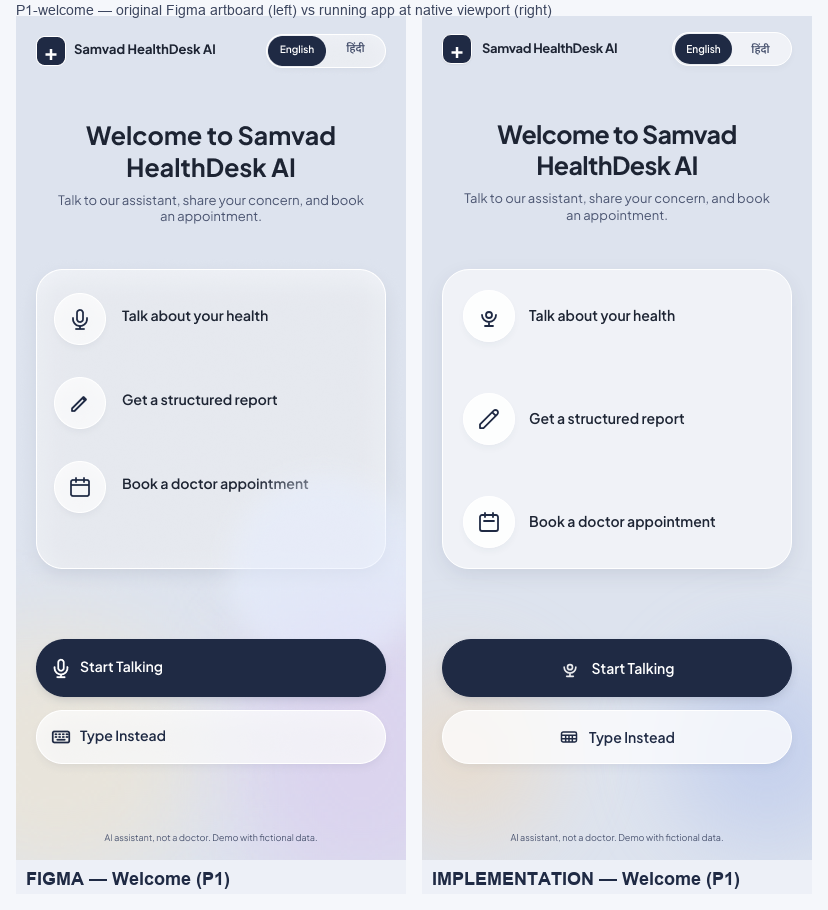

Matches: glow orbs at the exact Figma coordinates/sizes; brand mark 30×30 with wordmark; language pill 120×34 with the English segment active; title at y=103 and subtitle centred at 306 px; features card 350×300 at y=253 with three 52×52 icon wells; Start Talking 350×58 at y=623; Type Instead 350×54 at y=694; footer at y=816.

Differences (all minor):
1. Feature icons are Lucide-style approximations rather than the exported Figma vectors (pencil and calendar differ in geometry — I-10/I-11).
2. The keyboard glyph on "Type Instead" is a grid keyboard, not Figma's dotted keyboard (I-04).
3. Brand plus is a text glyph with different optical metrics (I-08).

## P2 — Consent (`72:42`) — **PARTIAL**

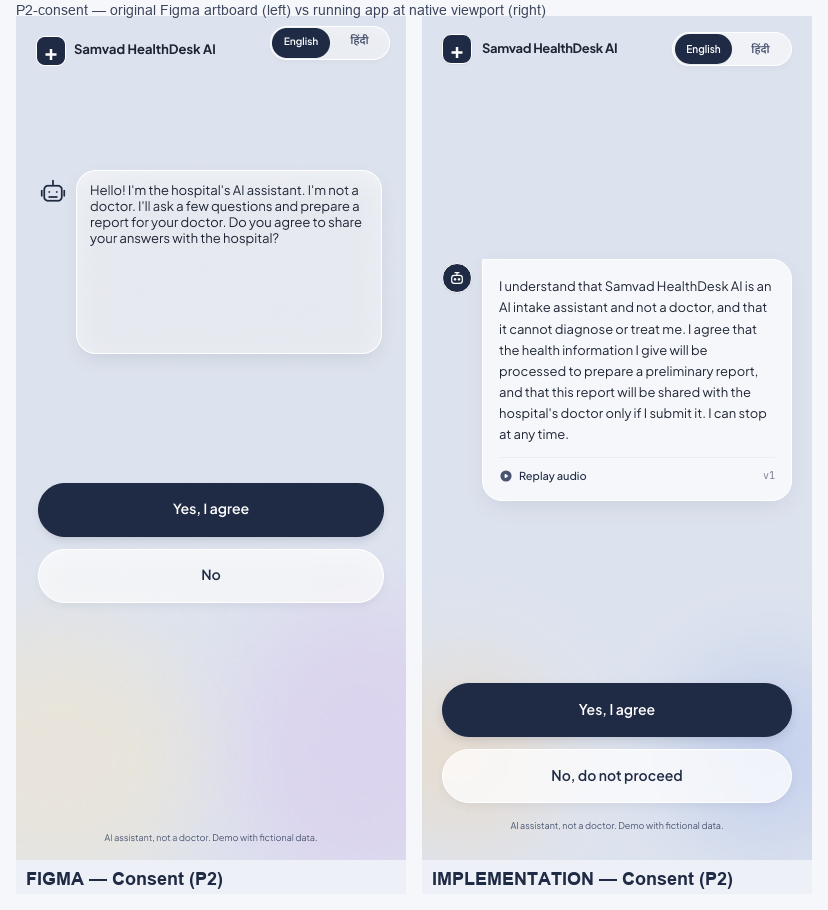

Differences:
1. **Copy.** Figma: "Hello! I'm the hospital's AI assistant. I'm not a doctor. I'll ask a few questions and prepare a report for your doctor. Do you agree to share your answers with the hospital?" Implementation renders the long versioned consent text (`types/consent.ts`). The Figma greeting exists in i18n as `consent.greetingAudio` but is never shown or spoken.
2. **Invented control.** A "Replay audio / Playing… / v1" row sits inside the bubble; it is not in Figma and does not play audio (D-06).
3. **Button copy.** Figma "No" vs implementation "No, do not proceed".
4. **Assistant avatar.** Figma is a bare 30×30 robot glyph; implementation puts the robot inside a filled navy circle (I-06).
5. Bubble height: Figma fixes 184 px with trailing whitespace; implementation hugs content.
6. The secondary button is labelled "No, do not proceed" but is styled identically to Figma's frosted pill — visually fine.

## P3 — Conversation (`72:66`) — **PARTIAL**

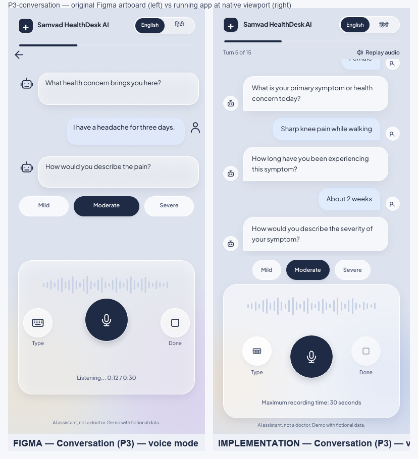

Matches: progress track, bubble geometry and colours (assistant frosted / patient pale blue), severity chip sizes and the dark "Moderate" chip, 35-bar waveform with identical heights, 86 px navy mic with the identical mic vector, 58 px Type/Done wells, status caption.

Differences:
1. **No back arrow at base** (present at HEAD, but at y=105 instead of Figma's y=80).
2. An extra row "Turn 5 of 15 … Replay audio" between the progress bar and the messages — not in Figma, and hardcoded English in Hindi mode.
3. Assistant avatar: circle container + different robot (I-06).
4. Patient avatar: circle container; Figma has no container (I-07).
5. Severity chip widths are equal (≈105 px) instead of 98/130/98.
6. Status text format "Maximum recording time: 30 seconds" (idle) and "Listening... 00:12 / 00:30" (recording) vs Figma's "Listening... 0:12 / 0:30" (single-digit minute).
7. Type/Done captions are 10 px; Figma ≈11 px.
8. In Hindi, "Turn … of 15", "Type" and "Done" remain English (D-26).
9. Assistant bubbles use a sharp bottom-left corner (`rounded-bl-sm`); Figma's are uniformly rounded.
10. In the 390 px capture the patient avatar is clipped at the right edge — evidence of the scrollbar-induced clip described in the method note (and a genuine clip at 360 px).

## P4 — Gender question (`72:121`) — **PARTIAL**

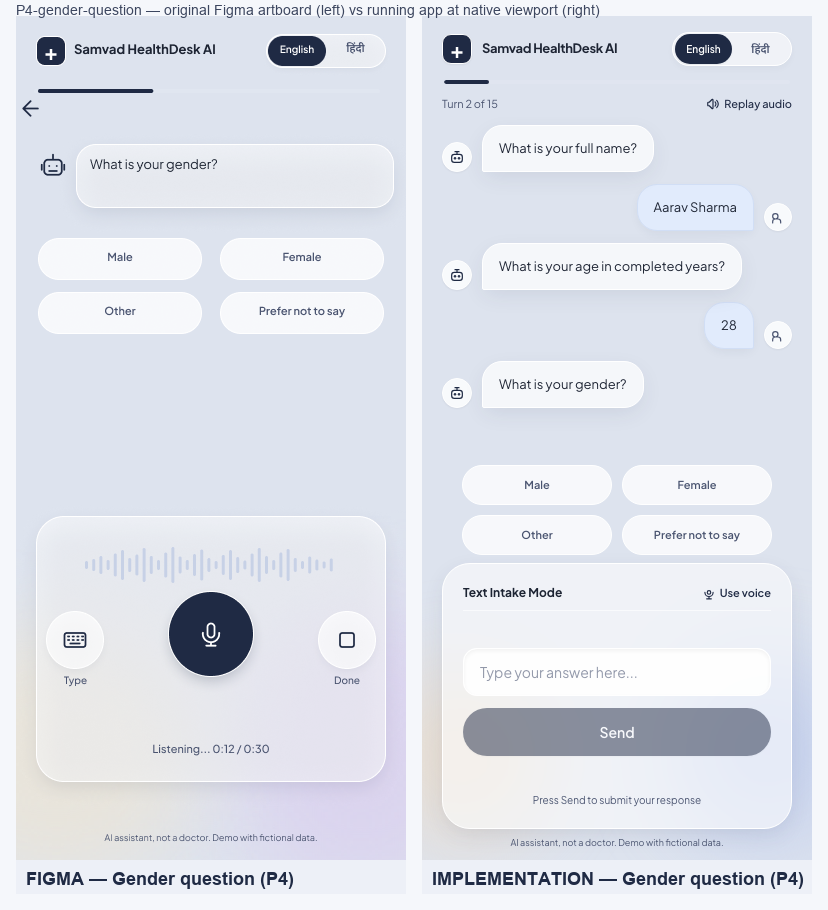

Matches: 2×2 frosted chip grid, assistant bubble, voice card.

Differences:
1. No back arrow at base (HEAD adds it).
2. Chips are 40 px high vs 42 px, and use equal widths inside a 350 px grid rather than Figma's 164 px pairs at x=22/204.
3. The Figma file has a 4 px progress misalignment (track x=18, value x=22) — correctly *not* copied.
4. No selected state is defined in either.

## P5 — What we heard (`72:167`) — **PARTIAL**

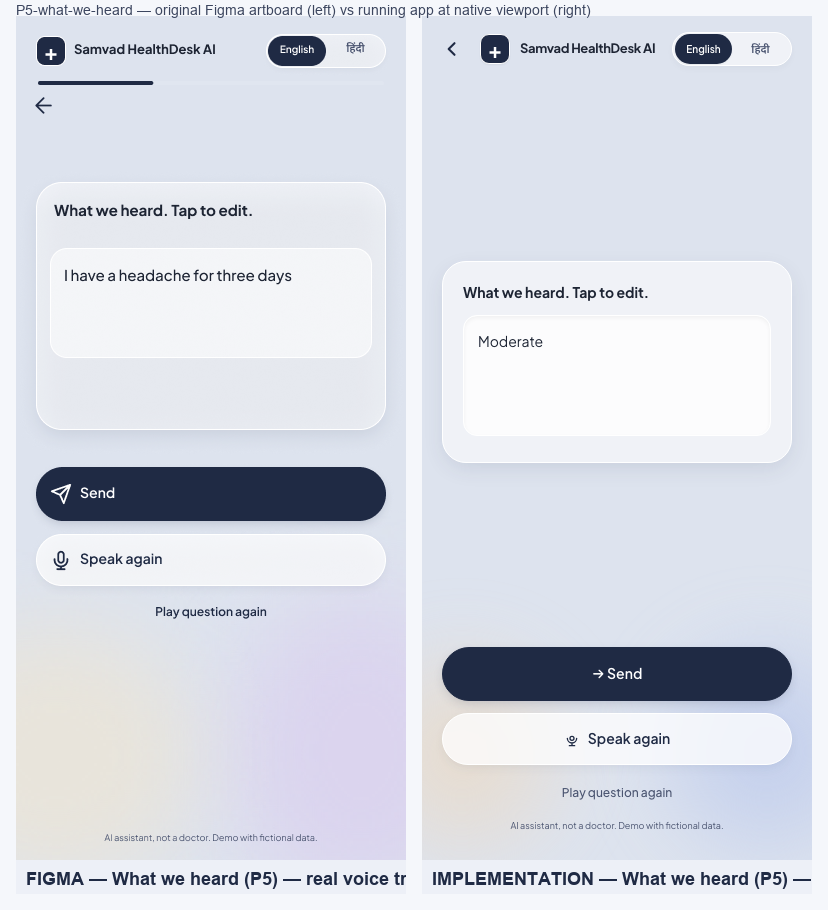

Matches: card position/structure, editable text, two stacked pills, "Play question again" link, progress bar.

Differences:
1. Send uses the text "→ Send" instead of the Figma paper-plane icon (I-13).
2. The transcript textarea is a bordered inner field; Figma's inner area has no visible border.
3. The header back arrow is a 20 px chevron, not the 25×25 Figma arrow.
4. "Play question again" navigates away instead of replaying (row 22 of the matrix).
5. Card height hugs content; Figma fixes 248 px.

## P6 — Processing (`72:192`) — **NOT IMPLEMENTED**

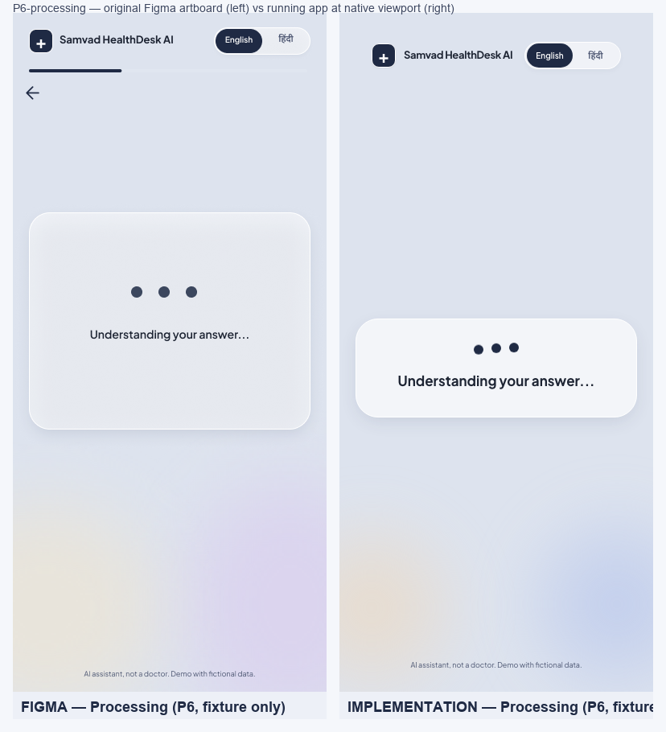

The comparison shows Figma on the left and the app's **fixture-only** rendering on the right. There is no route or state that shows this screen during real use: `ConversationView` renders a one-line inline "Processing your answer..." indicator instead. The fixture branch (`ConversationView.tsx:174-194`) is unreachable without `sessionStorage.FIGMA_PARITY_P3B_FIXTURE`.

## P7 — Mic denied (`72:209`) — **NOT IMPLEMENTED**

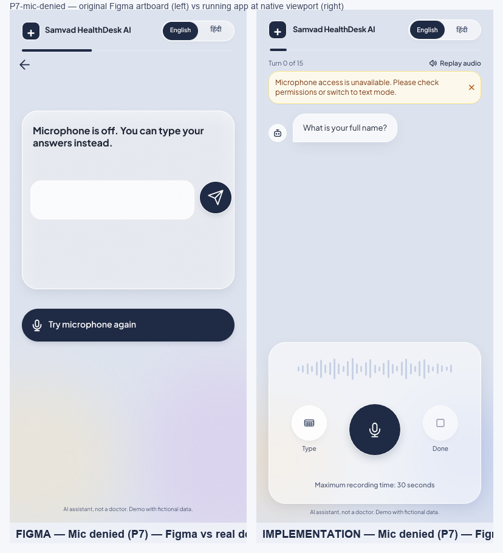

Left: Figma's MicDenied screen with a text field and "Try microphone again". Right: what a real denied microphone produces — an amber banner over the unchanged voice card. The Figma screen exists in code only as the `FIGMA_PARITY_P4B_FIXTURE` branch (`ConversationView.tsx:196-230`). No retry control, no automatic text mode (D-05).

## P8 — Report review (`72:235`) — **PARTIAL**

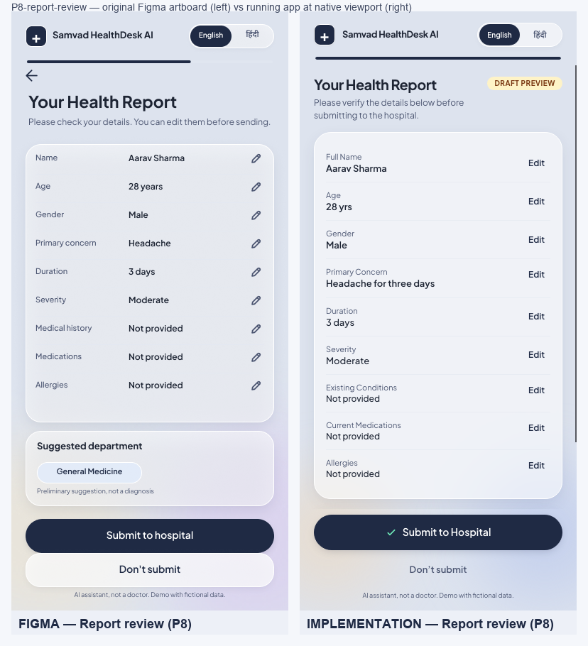

Matches: card stack, progress value at 2/3, department card, submit/don't-submit ordering, 9 rows of the same fields.

Differences:
1. Rows are **label above value**, left aligned; Figma is **label left / value at x=145**.
2. Edit affordance is the word "Edit" on the right instead of a 16×16 pencil (I-12).
3. An added "DRAFT PREVIEW" badge in the title row (not in Figma).
4. "Don't submit" is a transparent text link; Figma draws a 48 px frosted button.
5. Field labels differ: "Full Name"/"Existing Conditions"/"Current Medications" vs Figma "Name"/"Medical history"/"Medications".
6. Submit is h=50 vs 48.
7. No back arrow at base (HEAD adds it).
8. Missing values all read "Not provided" — Figma's sample shows the same, but the status collapse is a correctness issue (D-14).

## P9 — Booking (`72:301`) — **MISMATCH**

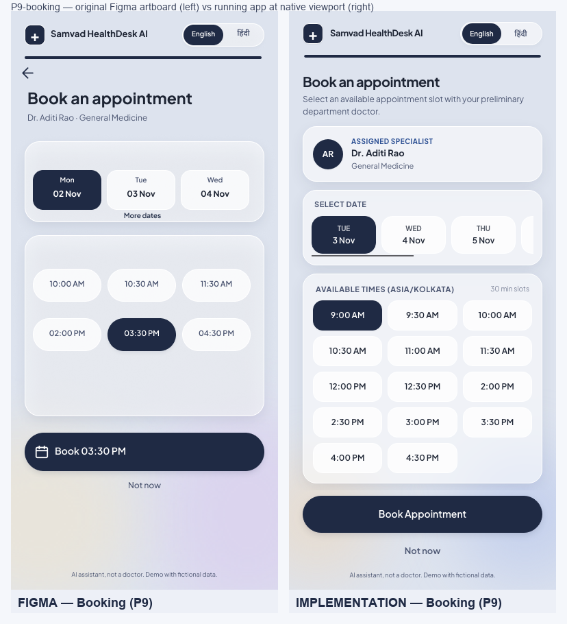

Differences (material):
1. Figma has **3 date chips + a "More dates" link**; the app has 7 chips in a horizontal scroller and **no More dates control**.
2. Figma shows **6 slot chips in a 3×2 grid**; the app shows **14 chips in 3×5**, which overflows the 844 px screen and scrolls under the footer.
3. Figma has no "Assigned Specialist" card; the app adds a doctor card with initials.
4. Figma's title block shows "Dr. Aditi Rao · General Medicine" as a subtitle; the app uses a generic subtitle and moves the doctor into the card.
5. Figma has no "SELECT DATE" / "AVAILABLE TIMES (ASIA/KOLKATA)" labels or "30 min slots" note.
6. Primary CTA: "Book 03:30 PM" with a calendar icon vs "Book Appointment" with no icon.
7. Figma's first selectable date is **today** (Mon 02 Nov); the app always starts at tomorrow.
8. No back arrow at base.

## P10 — No slots (`72:342`) — **MISMATCH**

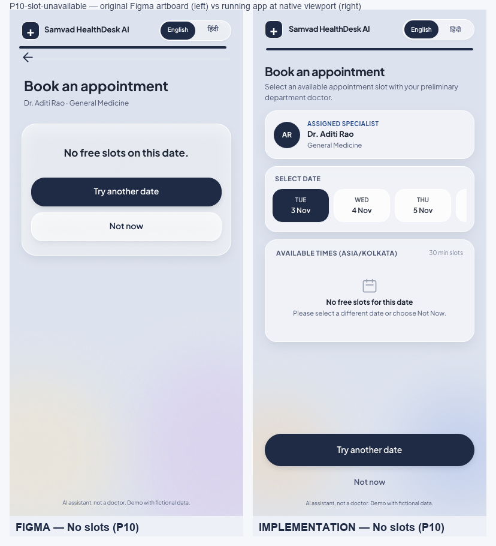

Figma is a dedicated screen: title, subtitle, one frosted card containing "No free slots on this date." plus **both** "Try another date" and "Not now" **inside the card**, then empty space. The app keeps the date card, doctor card and slot card, renders a small centred empty state inside the slot card, and puts "Try another date" and "Not now" in the footer — where "Try another date" is a **no-op button** (D-13). No back arrow at base.

## P11 — Slot taken (`72:361`) — **MISMATCH**

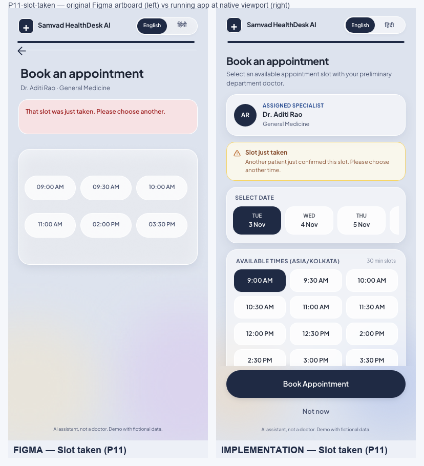

Figma: soft-red banner "That slot was just taken. Please choose another." followed by an alternative-slots card with six chips, and **no footer actions**. App: amber banner with a warning triangle, the full 14-slot grid with the date card still above it, plus footer CTAs that partially cover the grid. Colour, copy, structure and affordance all differ.

## P12 — Booking confirmation (`72:394`) — **PARTIAL**

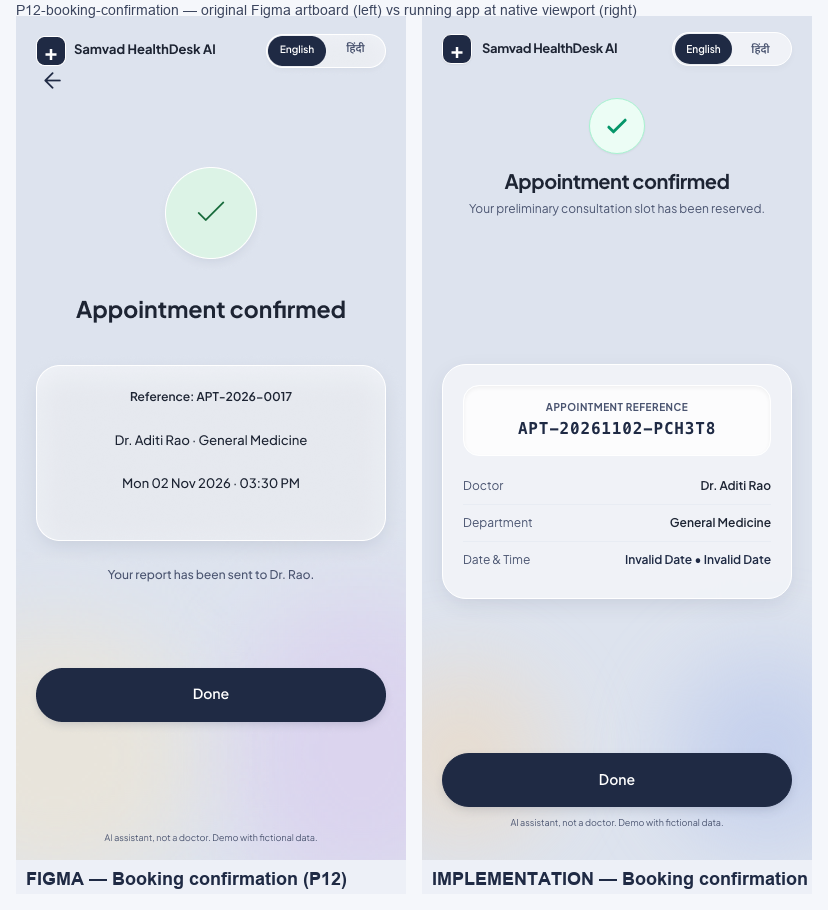

Differences:
1. Figma's details card is **centred stacked lines** ("Reference: …", "Dr. Aditi Rao · General Medicine", "Mon 02 Nov 2026 · 03:30 PM"); the app uses a reference box plus a label/value table.
2. Figma's note "Your report has been sent to Dr. Rao." is **absent** from the app.
3. Success circle: 92 px in Figma vs 56 px in the app.
4. The app adds a subtitle ("Your preliminary consultation slot has been reserved.") not in Figma.
5. **The date/time row renders "Invalid Date • Invalid Date"** in mock mode (D-03) — visible in the comparison.
6. No back arrow at base.

## P13 — Report sent (`72:417`) — **PARTIAL**

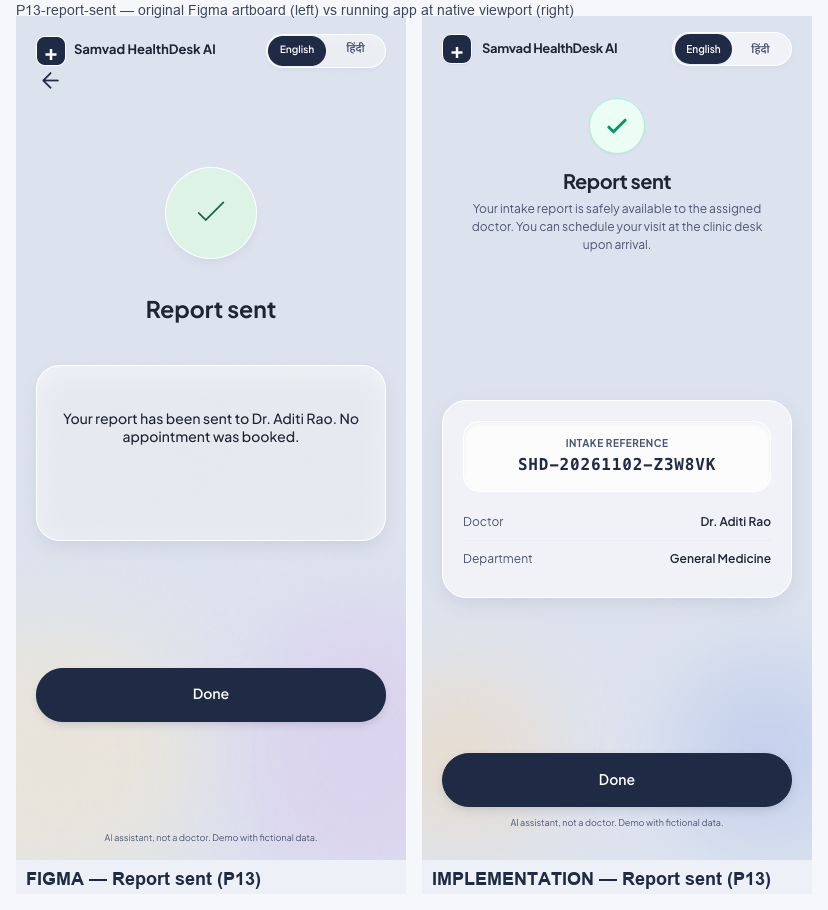

Differences:
1. Figma shows only the sentence "Your report has been sent to Dr. Aditi Rao. No appointment was booked."; the app adds an intake-reference box plus doctor/department rows (useful, but not Figma).
2. Success circle 56 vs 92 px.
3. Different subtitle copy.
4. No back arrow at base.

## P14 — Emergency (`72:436`) — **PARTIAL**

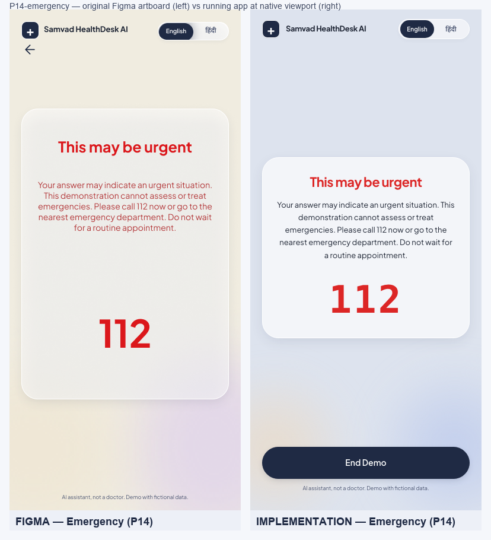

Matches: title, body copy (word for word in English), the large red 112, warm background, frosted card.

Differences:
1. The app adds a full-width "End demo" button; Figma has **no action button** in this frame.
2. No back arrow at base (HEAD adds one — which introduces D-02).
3. In Hindi the title and 112 are translated but the body paragraph stays **English** (D-07).
4. Card padding/title size differ slightly (22 px title vs Figma's ~24 px).

## P15 — Consent declined (`72:452`) — **MATCH**

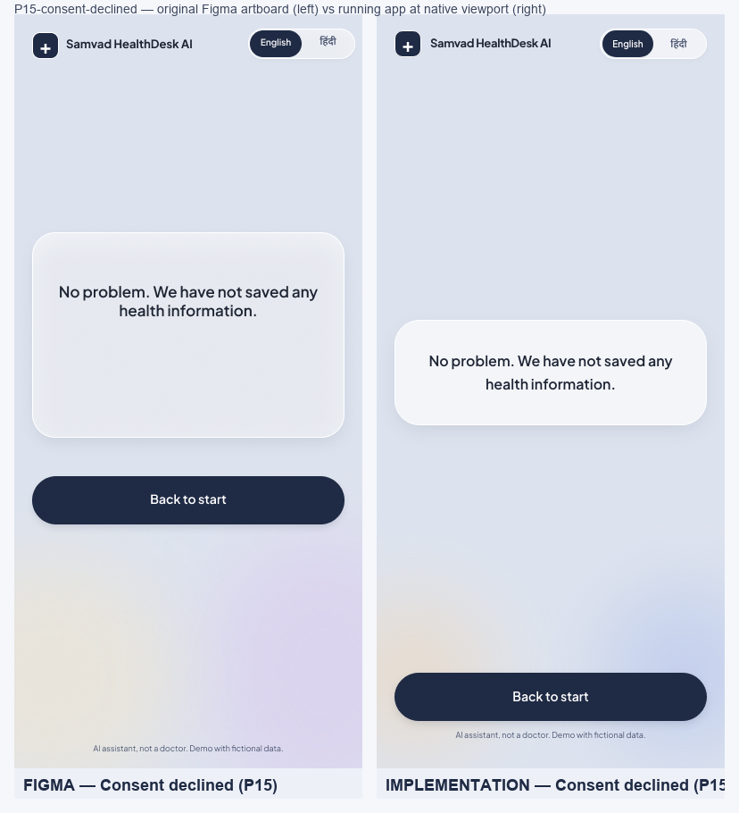

Matches: centre frosted card, copy, "Back to start" pill, glow background. Only differences: the card hugs its content rather than the fixed 230 px height, and the header includes the language pill at x=250 (Figma's is at 254,10 with a 1 px height difference). The refused-consent body text is hardcoded English (D-26).

---

## D1 — Doctor login (`74:2`) — **PARTIAL**

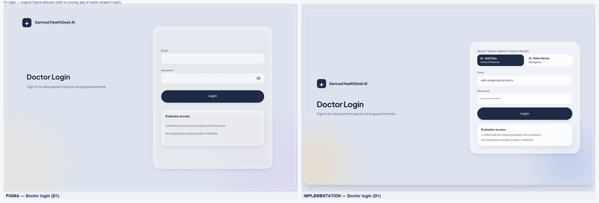

Matches: shell, brand, hero title/subtitle at the left, form card on the right, evaluator-access card copy exactly as required.

Differences:
1. Form card is 480 px wide vs Figma 520 px.
2. **No password visibility (eye) control** (I-23).
3. Mock mode adds a "Select Demo Identity" grid that is not in Figma.
4. At base there is no visible return navigation; HEAD adds one.
5. Vertical rhythm differs: the hero title sits higher than Figma's y=305.

## D2 — Doctor dashboard (`74:24`) — **MATCH**

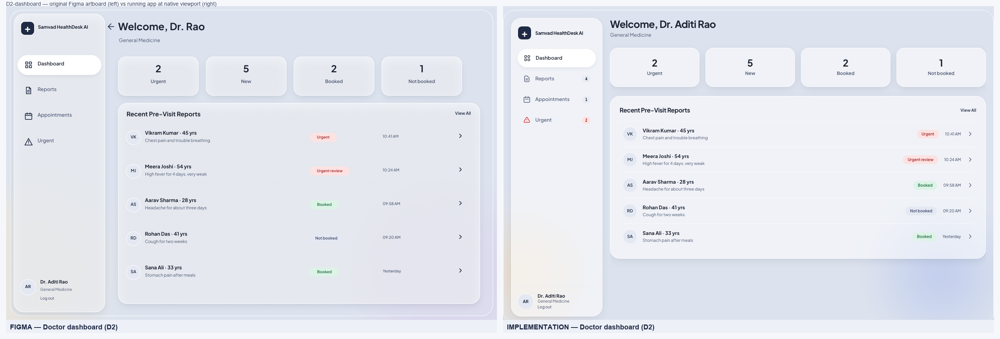

Excellent match: sidebar 238×780, brand, active pill, four metric cards at 210×102 with correct labels and values, recent-reports card with avatar/name·age/concern/status/time/chevron. Differences: the title reads "Welcome, Dr. Aditi Rao" vs Figma "Welcome, Dr. Rao"; the app adds count badges to the nav; Figma's back arrow before the title is intentionally omitted (dashboard is a home screen).

## D3 — Reports list (`74:125`) — **MISMATCH**

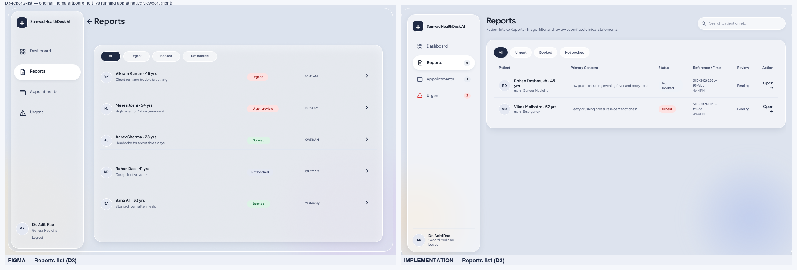

Figma is a **list card**: four pill tabs and rows of avatar / name·age / concern / status pill / time / chevron, with nothing else. The app renders a subtitle, a search field, and a **six-column table** with Review state and an "Open →" action. The information architecture changed: no table header in Figma, no search, no Review/Action columns, different row height and typography. This is functionally richer but not the approved design.

## D4 — Report detail (`74:220`) — **PARTIAL**

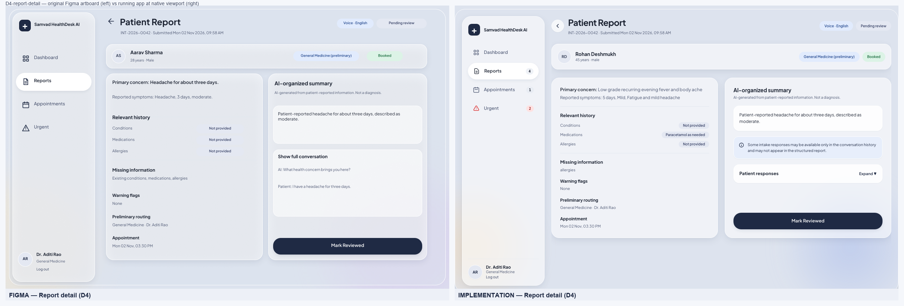

Matches: two-column card layout, patient banner with avatar/name/age·gender and department + status chips, details card sections in the same order, AI summary card with disclaimer, Mark Reviewed at the bottom of the right card.

Differences:
1. "Show full conversation" becomes "Patient responses / Expand ▼" (a justified divergence — the docs forbid showing fabricated assistant turns; the app shows the real stored patient answers, which is better).
2. Relevant-history values are rendered as grey pills; Figma right-aligns plain text.
3. Missing-information text is computed from values, not from `missing_information` (D-15).
4. "Warning flags: None" is hardcoded (D-01).
5. The appointment line is synthesised rather than read from data (D-35).
6. Source chip hardcoded "Voice · English" (D-33).
7. Back button is a 36 px circle with a 16 px chevron; Figma is a bare 25×25 arrow.

## D5 — Urgent detail (`74:307`) — **PARTIAL**

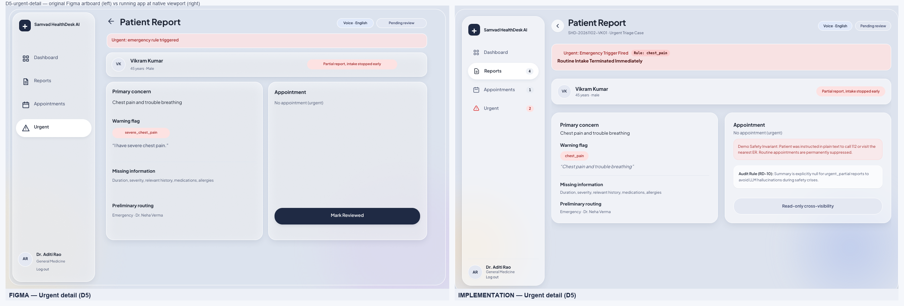

Differences:
1. Figma's emergency banner is a **thin 42 px full-width bar**; the app renders a taller card with a pinging dot, a rule chip and a second line ("Routine Intake Terminated Immediately").
2. Figma shows an **enabled "Mark Reviewed"** for the logged-in General Medicine doctor; the app shows "Read-only cross-visibility" (per the OD-03 read-only rule) — a documented conflict, not a coding error.
3. The app adds an "Audit Rule (RD-10)" note and a "Demo Safety Invariant" box, neither in Figma.
4. Missing-information and preliminary-routing text are hardcoded (D-35).
5. Patient card uses lowercase "male" from the report value.

## D6 — Appointments (`74:381`) — **MISMATCH**

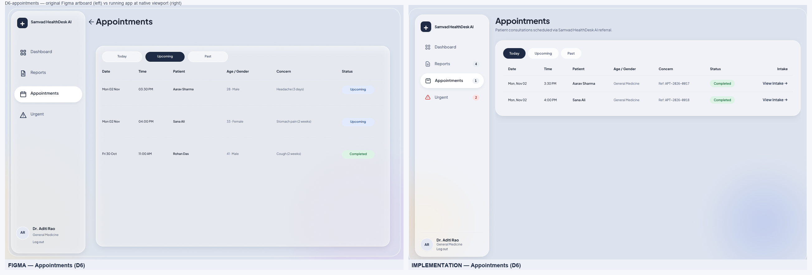

Figma columns: Date | Time | Patient | **Age / Gender** | **Concern** | Status. App columns: Date | Time | Patient | Age / Gender | Concern | Status | **Intake** — and the cell content does not match the headers: the "Age / Gender" column prints the **department name** and the "Concern" column prints **"Ref: APT-…"** (D-18). Figma's active tab is Upcoming; the app defaults to Today. Figma has no Intake column or "View Intake →" link.

## D7 — Urgent / Review (`74:455`) — **MISMATCH**

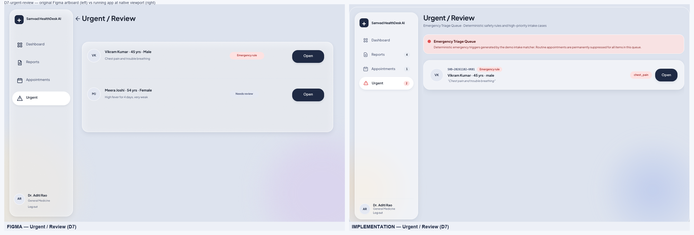

Figma: a two-row card (Vikram Kumar — "Emergency rule"; **Meera Joshi — "Needs review"**) with an "Open" button per row and no banner. App: a pinking safety banner explaining the queue, rows with an intake-reference line, a rule chip, and an "Open" button; the second row is missing because the queue filters on `status === 'urgent_partial'` only. Figma clearly intends `needs_human_review` reports to appear here; docs mark that inclusion as an open decision (RD-15), so this is a **design-vs-docs conflict to be ruled on**, not an implementation bug.

---

## Cross-screen summary of systemic differences

| Pattern | Frames affected |
|---|---|
| Missing back arrow (base) | P3, P4, P6, P7, P8, P9, P10, P11, P12, P13, P14, D1, D3, D6, D7 |
| Avatar containers/glyphs not Figma | P2, P3 |
| Lucide-style approximations instead of exported vectors | P1 (3 icons), P3 (keyboard), D1-D7 (nav icons) |
| Text used where Figma has an icon | P5 (send), P8 (edit pencils) |
| Extra controls not in Figma | P2 (audio row), P3 (turn/replay row), P8 (draft badge), P12/P13 (reference box), P14 (end-demo button), D1 (identity chips), D3 (search), D6 (intake column), D7 (safety banner) |
| Different information architecture | P9, P10, P11, D3, D6, D7 |
| Hardcoded English inside a bilingual screen | P2, P3, P5, P8, P12, P13, P14, P15 |
